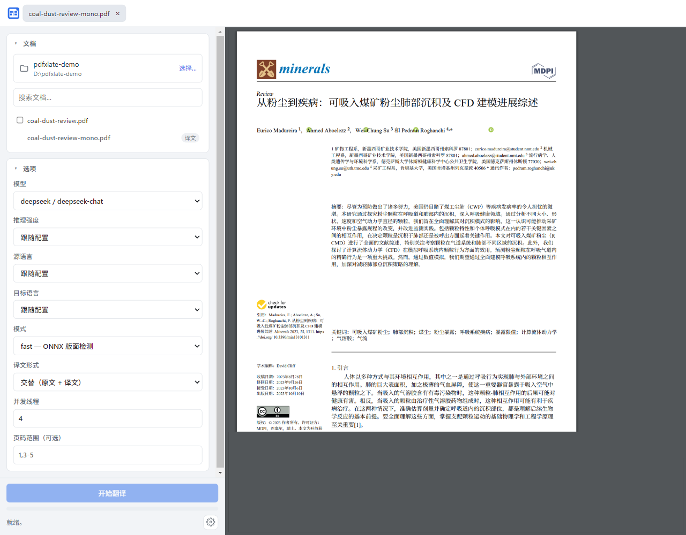

# pdfxlate

**简体中文** | [English](README.en.md)

保持版式的 PDF 文献翻译工具。把 PDF 交给任意 OpenAI 兼容的模型翻译，译文写回原来的
版面：分栏、标题、图片、表格与公式都留在原位。

[](LICENSE)
[](https://github.com/jk-uzi/pdfxlate/releases)
[]()



## 目录

- [功能](#功能)
- [下载与安装](#下载与安装)
- [从源码运行](#从源码运行)
- [使用](#使用)
  - [桌面端](#桌面端)
  - [命令行](#命令行)
  - [输出文件](#输出文件)
  - [通过 MCP 交给其他 agent](#通过-mcp-交给其他-agent)
- [配置](#配置)
- [支持的模型服务](#支持的模型服务)
- [架构](#架构)
- [构建安装包](#构建安装包)
- [测试](#测试)
- [已知限制与排错](#已知限制与排错)
- [参与贡献](#参与贡献)
- [许可证与致谢](#许可证与致谢)

## 功能

- **保持版面**：先识别每页的版面区域（标题、正文、图片、表格、公式），只翻译正文，
  再把译文按原字号与行宽回填到页面，图片和公式保持不动。
- **两种输出**：
  - `*-mono.pdf` —— 只有译文
  - `*-dual.pdf` —— 原文与译文逐页交替，方便对照校对
- **两种版面检测方式**：
  - `fast`（默认）—— 渲染页面后跑 DocLayout-YOLO 的 ONNX 模型，按类别保护图片与表格，
    质量最好；
  - `ultrafast` —— 直接使用 PDF 里的原生文本坐标，不需要下载模型、速度更快，但复杂
    多栏版面会退化。
- **任意 OpenAI 兼容服务**：OpenAI、DeepSeek、通义千问（DashScope）、Moonshot、
    智谱 GLM、Groq、xAI、OpenRouter、SiliconFlow，以及本地的 vLLM / Ollama / LM Studio。
  另外支持 OpenAI Responses 与 Anthropic Messages 两种 API 形态。
  一个供应商只配一次地址与密钥，下面可以挂任意多个模型。
- **外部 Agent CLI**：在「设置 → Agents」里把 Claude Code、Codex、
  WorkBuddy/CodeBuddy、ZCode、DeepSeek Harness 的模型接进来，用它们各自的登录与
  额度翻译，不需要 API key；CLI 不在 PATH 时可以手动指定路径。
- **桌面端**：左侧浏览文件夹并勾选要翻译的文件，右侧是同窗口内的 PDF 预览；打开过的
  文件以标签页排列，可以拖动排序。翻译产物与源文件并排显示在列表里，并标记为「译文」，
  因此可以直接对照原文和结果。
- **翻译缓存**：以「引擎 + 参数 + 原文」为键的本地 SQLite 缓存，重复段落不会再次
  计费；任务结束后会显示命中数与未命中数。
- **MCP**：可以把翻译能力交给其他 agent 调用，使用你在应用里配置的模型，或者直接让
  agent 用自己的模型翻译。
- **中英双语界面**：首次启动按系统语言自动选择，可在「设置 → 外观」里切换并记住。

## 下载与安装

从 [Releases](https://github.com/jk-uzi/pdfxlate/releases) 下载最新版 Windows 安装包
（形如 `pdfxlate-Setup-0.2.0.exe`，约 193 MB）。

- **系统要求**：Windows 10 或 11，64 位。安装按当前用户进行，不需要管理员权限。
- **未签名**：安装包没有代码签名证书，首次运行 Windows SmartScreen 会提示
  「Windows 已保护你的电脑」。点击「更多信息 → 仍要运行」即可。
- **首次翻译需要联网**：安装包里已经带了默认的中文字体（思源宋体），但版面检测模型
  （约 75 MB）在首次使用时下载。下载源依次是 `huggingface.co` 与 `hf-mirror.com`，
  成功后记住可用入口。翻译本身也需要访问你配置的模型服务。
- 如果启动时报 ONNX Runtime 的 DLL 加载失败，安装
  [Microsoft Visual C++ 运行库](https://aka.ms/vs/17/release/vc_redist.x64.exe)。

Linux 与 macOS 的打包配置已在仓库里，但当前只实际构建并验证过 Windows 安装包与
Linux AppImage；macOS 安装包尚未验证，需要自行构建。

## 从源码运行

需要 Node.js 18+ 与 Python 3.11–3.12。

```bash
# 1. Python 引擎
cd python
python -m venv .venv
.venv/bin/pip install -e .            # macOS / Linux
# .venv\Scripts\pip install -e .      # Windows
cd ..

# 2. 桌面端
npm install

# 3. 启用提交前密钥扫描（每个克隆一次）
git config core.hooksPath .githooks
```

第 3 步安装的 git hook 会阻止密钥进入提交：装了 `gitleaks` 就用它，没装则退回正则匹配，
不需要联网。想启用基于熵的完整检测可以再执行：

```bash
go install github.com/zricethezav/gitleaks/v8@latest
```

启动桌面端：

```bash
npm run dev      # 开发模式，带 DevTools
npm start        # 普通启动
```

## 使用

### 桌面端

1. 点击「选择…」挑一个文件夹，其中的 PDF 会列在左侧（包括 `translated/` 子目录里
   以前生成的译文）。
2. 勾选要翻译的文件，在「选项」里选模型、源语言、目标语言、版面模式与译文形式。
3. 点「开始翻译」。进度、缓存命中情况和错误都会显示在左下角；同一个按钮可以取消。
4. 完成后结果出现在 `translated/` 子目录里，也会出现在文件列表中并标记为「译文」，
   点击即可在右侧预览。

也可以直接把 PDF 拖进窗口，文件会被放进当前文件夹并打开。

### 命令行

```bash
cd python
.venv/bin/pdfxlate paper.pdf --provider deepseek --model chat -o out/
.venv/bin/pdfxlate --list-models              # 列出所有 供应商 → 模型
.venv/bin/pdfxlate paper.pdf --pages 1-5 --output-mode mono
```

常用参数：

| 参数 | 说明 |
|---|---|
| `--provider` / `--model` | 选择供应商与模型别名；省略时用配置里的第一个可用模型 |
| `-o, --output` | 输出目录；省略时写到源文件旁的 `translated/` |
| `--output-mode` | `mono` / `dual` / `both`（命令行默认 `both`，桌面端只提供前两种） |
| `--pages` | 只翻译指定页，如 `1-5,8` |
| `--mode` | `fast`（默认）或 `ultrafast` |
| `--thread` | 并发线程数 |
| `--lang-in` / `--lang-out` | 源语言与目标语言 |
| `--ignore-cache` | 本次忽略缓存，强制重新翻译 |
| `--backend` | ONNX 后端：`auto` / `cpu` / `cuda` / `dml` |
| `--config` | 指定 `config.yaml` 路径 |
| `--config-dir` | 覆盖**配置目录**（缓存与模型仍使用平台目录，便于命令行与桌面端共用一份） |

### 输出文件

输入 `paper.pdf` 会得到：

```
translated/paper-mono.pdf    只有译文
translated/paper-dual.pdf    原文与译文交替
```

输出目录里已有同名文件时不会覆盖，而是依次加 ` (2)`、` (3)`，单语与双语文件一同编号。

### 通过 MCP 交给其他 agent

pdfxlate 可以作为 [Model Context Protocol](https://modelcontextprotocol.io) 服务端，
让别的 agent 调用翻译能力，**使用它自己的模型**（client sampling）或你在应用里配置的
模型（provider）。

最省事的做法是打开应用的「设置 → MCP」：它会显示已经填好路径的配置片段，并能写进本机
检测到的 Claude Desktop、Claude Code、Codex、WorkBuddy、ZCode。写入前先备份目标文件，
只添加自己的那一项，其余内容原样保留。其他客户端可以手工粘贴。

从源码使用时，需要先安装可选依赖：

```bash
cd python
.venv/Scripts/pip install -e ".[mcp]"    # Windows
.venv/bin/pip install -e ".[mcp]"        # macOS / Linux
```

手工配置示例（Windows 用 `.venv\Scripts\python.exe`）：

```json
{
  "mcpServers": {
    "pdfxlate": {
      "command": "/path/to/python/.venv/bin/python",
      "args": ["-m", "pdfxlate.sidecar", "--mcp",
               "--config-dir", "/path/to/your/userData"]
    }
  }
}
```

`--config-dir` 让服务端读取与桌面端**同一个** `config.yaml`，因此界面上配好的供应商
和模型就是它使用的。

可用的工具：

| 工具 | 作用 |
|---|---|
| `list_providers` | 列出已配置的供应商与模型（永远不返回密钥） |
| `extract_segments` | 收集可翻译段落并返回 `job_id` |
| `typeset_translations` | 用你提供的译文回填这个 `job_id` |
| `translate_pdf` | 一次调用完成整个翻译 |

`translate_pdf` 的 `translator` 取 `provider`（使用 `config.yaml` 里的模型）或
`client`（通过 MCP sampling 让 agent 自己的模型翻译，需要客户端支持 `sampling`）。
`extract_segments` + `typeset_translations` 是同一个引擎的两段式接口，任何客户端都能用：
先取出段落，用你喜欢的方式翻译，再交回来排版。

**通过 MCP 只能读配置**：故意没有新增/修改供应商、模型或写入密钥的工具，因此把 agent
指向这个服务端不会改动你的设置。

MCP 服务是独立的 stdio 进程，共享配置、缓存与已下载的资源，但不共享桌面端的内存状态：
它不会复用已加载的版面模型，任务也不会出现在应用的进度面板里。

## 配置

`config.yaml` 位于平台配置目录：

| 平台 | 位置 |
|---|---|
| Windows | `%APPDATA%\pdfxlate\config.yaml` |
| macOS | `~/Library/Application Support/pdfxlate/config.yaml` |
| Linux | `$XDG_CONFIG_HOME/pdfxlate/config.yaml`（默认 `~/.config/pdfxlate/`） |

桌面端使用 Electron 的 `userData` 目录，位置相同。首次启动会写出一份带注释的模板。

```yaml
# 这个文件描述「有哪些」，不指定「用哪个」。每次运行单独选模型（选项面板、
# --provider/--model 或 MCP 工具参数），所以没有「默认模型」这个概念。
providers:
  deepseek:
    kind: openai_compat
    base_url: https://api.deepseek.com/v1
    api_key: ${DEEPSEEK_API_KEY}   # 从进程环境变量展开
    models:
      chat:
        model: deepseek-chat
        temperature: 0             # 0 能更好地保住 {vN} 公式占位符
        context_length: 65536      # 模型窗口，用于告警，不会自动改写 max_tokens
      reason:
        model: deepseek-reasoner
        reasoning_effort: high     # 可选，原样透传
        max_tokens: 8192           # 可选，不写则交给 API 决定

  local_vllm:
    base_url: http://127.0.0.1:8000/v1
    api_key: dummy
    models:
      qwen:
        model: Qwen/Qwen3-32B
        extra_body:                # 任意供应商特有字段
          chat_template_kwargs:
            enable_thinking: true

translation:
  lang_in: en
  lang_out: zh
  thread: 4
  mode: fast                       # fast | ultrafast

layout:
  backend: auto                    # auto | cpu | cuda | dml

cache:
  enabled: true
```

说明：

- `${VAR}` 从**进程环境变量**读取。变量未设置时展开为空字符串，并被报告为「未配置」，
  不会把字面量发给服务端。保存配置时不会把展开后的密钥写回文件。
- 项目**不读取 `.env` 文件**（没有 dotenv 依赖）。仓库里的 `.env.example` 只是列出常用
  密钥变量名，请用 shell、系统环境变量或启动器设置它们。
- `--config-dir` 只改变**配置**目录；缓存与已下载的模型/字体固定使用平台目录，这样
  命令行、桌面端与 MCP 共用同一份，不会为了同一个模型重复下载 75 MB。
- 旧的扁平 `profiles:` 配置会在加载时自动迁移为 `providers:`，旧命令行里的
  `--profile` 仍然可用。
- 配置校验严格：未知字段会直接报错，避免拼写错误被静默忽略。

## 支持的模型服务

| API 形态（`kind`） | 端点 | 典型服务 |
|---|---|---|
| `openai_compat`（默认） | `/v1/chat/completions` | OpenAI、DeepSeek、DashScope、Moonshot、GLM、Groq、xAI、OpenRouter、SiliconFlow、vLLM、Ollama、LM Studio |
| `openai_responses` | `/responses` | 支持 Responses API 的服务 |
| `anthropic_messages` | `/v1/messages` | Anthropic Claude |

每个模型可以单独设置 `temperature`、`top_p`、`max_tokens`、`stream`、
`reasoning_effort`、`context_length` 与 `extra_body`。适配器对所有请求都带指数退避重试
（最多 8 次），并会检查译文里的 `{vN}` 公式占位符是否完整，损坏时拒绝写入页面。

要接一个新的后端，写一个适配器类即可，PDF 管线不需要改动：

```python
# python/pdfxlate/models/my_backend.py
from pdfxlate.models.base import ModelAdapter, register

@register
class MyBackend(ModelAdapter):
    name = "my_backend"            # 注册表键名，也是缓存命名空间

    def do_translate(self, text: str) -> str:
        ...                        # 返回译文，保持 {vN} 不变
```

在 `pdfxlate/models/__init__.py` 里导入它，然后把供应商的 `kind` 设为 `my_backend`。

## 架构

```
Electron（TypeScript）              Python sidecar
  renderer  — 界面                    pipeline — 解析、检测版面、翻译、排版
  main      — 窗口、IPC               models   — 模型适配器
  preload   — contextBridge                 │
        │                                   │
        └────── 逐行 JSON，经 stdin/stdout ──┘

外部 agent（MCP 客户端）              Python MCP 服务
        │                                   │
        └────────── MCP over stdio ─────────┘  同一套核心，同一份 config.yaml
```

- **为什么用 stdin/stdout 而不是本地 HTTP**：不占用端口（不会弹防火墙提示）、不需要
  token 认证、父进程退出时自然结束。MCP 服务出于同样的理由选择 stdio。
- **PDF 引擎用 Python**：`pdfminer.six` 负责内容流解析，`PyMuPDF` 负责渲染与写回，
  ONNX Runtime 跑版面模型。引擎用 PyInstaller 打包后随应用一起发布。
- **界面不直接碰 Node**：渲染进程只能通过 preload 里显式暴露的窄接口 IPC，且开启了
  `contextIsolation`、关闭了 `nodeIntegration`。
- **缓存**：SQLite（`cache.v1.db`，WAL 模式），键是 `(引擎, 参数, 原文)`，因此同一段
  原文在不同模型下分别缓存。任务结束会同时报告本地命中数和供应商侧的 prompt cache
  用量（如果服务端返回）。

目录结构与「改某个功能该动哪个文件」见 [docs/project-structure.md](docs/project-structure.md)，
架构与移植决策见 [docs/development-plan.md](docs/development-plan.md)。

## 构建安装包

```bash
npm install
bash scripts/build.sh          # Windows 上用 Git Bash
```

脚本依次做四件事：把中文字体放进 sidecar 包、用 PyInstaller 构建 Python 引擎、编译
TypeScript、用 electron-builder 打包。产物在 `dist/`：

- `dist/win-unpacked/` —— 可直接运行的目录，适合快速验证
- `dist/pdfxlate Setup <版本>.exe` —— Windows NSIS 安装包
- `npm run pack` 只生成未打包的目录

数值说明：未压缩的 `win-unpacked/` 约 589 MB（Python 运行时与依赖占大头），安装包约
193 MB。

第一次运行 electron-builder 会下载 NSIS 与 winCodeSign。`scripts/build.sh` 默认把
binary 镜像指向 npmmirror，因为在部分网络下 `github.com` 的 release 资源不可达；可以
用 `ELECTRON_BUILDER_BINARIES_MIRROR` 换成别的镜像。

PyInstaller 的产物与平台绑定，每个目标平台都要在对应系统上构建。签名尚未配置：未签名
的产物在 Windows 上会触发 SmartScreen，在 macOS 上会触发 Gatekeeper。

## 测试

```bash
cd python && .venv/bin/python -m pytest ../tests -q
# Windows: .venv\Scripts\python -m pytest ..\tests -q

npm run typecheck     # main/preload 与 renderer 两套 tsconfig
npm run check:i18n    # 中英文案表必须键、占位符、取值一一对应
```

Python 侧的测试覆盖适配器（对着本地真实 HTTP 服务，含 SSE）、配置与迁移、缓存与占位符、
版面与排版、sidecar 协议与取消、MCP 两段式流程等。前端没有 DOM 自动化测试，界面改动
靠手工与 DevTools 验证。

## 已知限制与排错

- **超长译文可能溢出**：文本换行逻辑沿用参考实现的行为，很短的原文块如果译成很长的
  句子，右边界可能超出几个点。保持 `temperature: 0` 并使用简洁的提示词可以缓解。
- **`ultrafast` 的保护较弱**：它只按位置远近避开图形，不按类别识别图片与表格，复杂版面
  建议用 `fast`。
- **加密 PDF 不支持**：没有处理需要密码的文档。
- **扫描件需要 OCR**：纯图片页面会先用 Tesseract 生成文本层（需要下载对应语言数据）。
  OCR 目前只能通过配置文件调整，界面上没有开关。
- **预览的限制**：预览使用 Chromium 内置 PDF 查看器，装在 `file://` 的 iframe 里，
  外层页面无法脚本化它。因此页码以应用自己记录的为准；直接拖到预览页面上的文件会被
  查看器接管，拖到四周边框才会由应用处理。
- **首次运行慢**：需要下载约 75 MB 的版面模型；下载失败会自动换另一个入口重试。
- **SmartScreen / Gatekeeper**：见 [下载与安装](#下载与安装)。

## 参与贡献

- 提交前请启用 `git config core.hooksPath .githooks`，它会在暂存区扫描密钥与大文件。
- 误报请改 `.gitleaks.toml` 的白名单，不要用 `--no-verify` 绕过。
- 改动界面文案后跑 `npm run check:i18n`；新增文案要同时补中英文。
- `references/` 是上游项目的只读副本，不参与构建，也不要从中 import。
- 开发记录（每次任务的进展、踩过的坑、待办）写在 `requirements/development-log.md`。

## 许可证与致谢

本项目以 [AGPL-3.0-or-later](LICENSE) 发布。

- 版面检测与排版回填的实现参考了
  [PDFMathTranslate](https://github.com/Byaidu/PDFMathTranslate)，但本仓库是独立实现，
  不包含它的代码。
- [PyMuPDF](https://github.com/pymupdf/PyMuPDF) / MuPDF 同为 AGPL；如需闭源分发，必须
  向 [Artifex](https://artifex.com/licensing/) 购买商业许可。
- 版面模型：[DocLayout-YOLO](https://huggingface.co/wybxc/DocLayout-YOLO-DocStructBench-onnx)。
- 字体：[Source Han Serif](https://github.com/adobe-fonts/source-han-serif)（SIL OFL）
  与 [Go Noto](https://github.com/satbyy/go-noto-universal)。
- OCR 数据：[tesseract-ocr/tessdata_fast](https://github.com/tesseract-ocr/tessdata_fast)。
